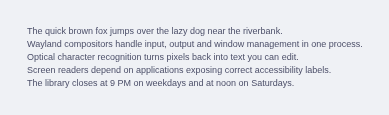

# omarchy-ppocr

**Much more accurate screen OCR for [Omarchy](https://omarchy.org), CPU-only, fully offline.**

Swaps the engine behind <kbd>Super</kbd> + <kbd>Ctrl</kbd> + <kbd>Print</kbd> (Omarchy's "Extract text (OCR)") from Tesseract to **PaddleOCR PP-OCRv6** running on ONNX Runtime. Same flow you already know: freeze the screen, select a region, and the text goes to your clipboard.

- **7× fewer character errors and 5× fewer word errors** than Omarchy's default on a 100-image screen-text benchmark (CER 2.8% → 0.4%, WER 10.3% → 2.0%).
- **Perfect transcriptions on 70% of images** (Tesseract: 39%). A blind LLM judge preferred it 61 times to 8 (31 ties).
- **No GPU needed.** On a 15 W laptop CPU a capture takes **≈0.7 s** with the model kept warm (≈1.4 s cold). The warm server uses ≈270 MB and exits after 10 idle minutes.
- **Multilingual out of the box.** One model covers English, most Latin-script languages with accents, Chinese and Japanese.
- **Nothing leaves your machine.**
- Ships as an **Omarchy shell plugin** (or a plain install script).

The trade-off is that it's **slower than Tesseract (≈0.7 s warm vs ≈0.3–0.4 s)** and uses more RAM. Details and every number are below.

---

## Example



| Omarchy default (Tesseract) | omarchy-ppocr |
|---|---|
| The ck brown ox amps over th lazy dog near th rverbank.<br>Wayland composiors handie nut, ouput and window management none proces.<br>Opal characte recogni pees Back no txt you can edt.<br>Screen readers depend on appcations expose cect acessibiy bes.<br>“Th rary closes a5 PM an eokdays and at oon on Saturdays. | The quick brown fox jumps over the lazy dog near the riverbank.<br>Wayland compositors handle input, output and window management in one process.<br>Optical character recognition turns pixels back into text you can edit.<br>Screen readers depend on applications exposing correct accessibility labels.<br>The library closes at 9 PM on weekdays and at noon on Saturdays. |

This is the biggest difference in the benchmark. Small fonts at 1× scale are where Tesseract struggles most.

## Install

### As an Omarchy plugin

```bash
omarchy plugin add https://github.com/devrahulbanjara/omarchy-ppocr.git --enable
```

On first load the plugin opens the installer in a floating terminal and explains what it will do before asking. The plugin system itself never runs installers. After that, the plugin pre-warms the OCR model when the shell starts and adds IPC commands:

```bash
omarchy-shell ppocr capture   # select a region and copy its text (same as the key)
omarchy-shell ppocr install   # (re)run the installer
omarchy-shell ppocr warm      # load the model now
omarchy-shell ppocr stop      # free the warm model's memory
```

Update with `omarchy plugin update io.github.devrahulbanjara.ppocr`. Remove it with `~/.config/omarchy/plugins/io.github.devrahulbanjara.ppocr/install.sh --uninstall`, then `omarchy plugin remove io.github.devrahulbanjara.ppocr`.

### Without the plugin

```bash
git clone https://github.com/devrahulbanjara/omarchy-ppocr.git
cd omarchy-ppocr
./install.sh
```

Either way, the installer:

1. Creates a private Python 3.12 environment in `~/.local/share/omarchy-ppocr/venv`, with `rapidocr` and `onnxruntime` pinned. It uses `uv` if available and falls back to `python3 -m venv`. No sudo.
2. Installs `omarchy-ppocr-capture` and `omarchy-ppocr-extract` into `~/.local/bin`.
3. Downloads the PP-OCRv6 small models (about 31 MB, one time) and runs a self-test.
4. Backs up `~/.config/hypr/bindings.lua` and rebinds <kbd>Super</kbd> + <kbd>Ctrl</kbd> + <kbd>Print</kbd> inside a clearly marked block. It then validates the config with `hyprctl configerrors`.

```bash
./install.sh --no-bind     # install but leave keybindings alone
./install.sh --uninstall   # remove everything; Omarchy's default OCR comes back
```

### Use it from the command line

```bash
omarchy-ppocr-extract screenshot.png           # print the text in an image
grim -g "$(slurp)" - | omarchy-ppocr-extract   # or read from stdin
omarchy-ppocr-extract --status                 # is the warm server running?
```

### Configuration (environment variables)

| Variable | Default | Meaning |
|---|---|---|
| `OCR_MODEL_SIZE` | `small` | `tiny` (faster, lighter, CER 0.7% vs 0.4%) or `small`. `medium` took ≈12 s per capture on a laptop CPU, so it isn't recommended. |
| `OCR_THREADS` | `4` | ONNX Runtime threads. Using every core was *slower* on hybrid P/E-core laptop CPUs. |
| `OMARCHY_PPOCR_IDLE` | `600` | Seconds before the warm server exits when unused (`0` = never). |
| `OMARCHY_PPOCR_DAEMON` | `1` | `0` = never use or start the warm server (always cold, no memory kept). |
| `OCR_DET_LIMIT_TYPE` / `OCR_DET_LIMIT_SIDE` | `min` / `320` | Detection resize. RapidOCR's default (`min 736`) upscales wide selections about 3× and doubles latency without improving accuracy on screen text. |
| `OCR_TEXT_SCORE`, `OCR_BOX_THRESH`, `OCR_DET_THRESH`, `OCR_UNCLIP` | `0.5`, `0.5`, `0.3`, `1.6` | Confidence and detection thresholds. Tuning them showed no gain on the dev set. |

Each distinct set of `OCR_*` values gets its own warm server, so changing a setting never returns results from a server running a different configuration. To set them for the keybinding, edit the `o.bind` line to e.g. `env OCR_MODEL_SIZE=tiny omarchy-ppocr-capture`.

## Dependencies, network and permissions

- **Python packages** (installed into a private environment, pinned): `rapidocr==3.10.0`, `onnxruntime==1.31.0`, plus their dependencies (`numpy`, `opencv-python-headless`, `shapely`, `pyclipper`, …). About 150 MB on disk.
- **Models:** PP-OCRv6 small detection and recognition (≈31 MB), downloaded once from RapidAI's ModelScope mirror. SHA-256 is verified against the hashes pinned in that RapidOCR release.
- **Network:** only during install (package and model download). OCR itself is fully offline; images and text never leave your machine.
- **Permissions:** no sudo, no system files. The installer writes only to `~/.local/share/omarchy-ppocr`, `~/.local/bin`, and a clearly marked block in `~/.config/hypr/bindings.lua`. It backs that file up first; skip it with `--no-bind`.
- **Already on Omarchy:** `grim`, `slurp`, `wl-copy`, `hyprpicker`, `tesseract` (used as the fallback).

## How it works

```
Super+Ctrl+Print
  └─ hyprpicker -r -z         freeze the screen (same as Omarchy)
  └─ slurp                    select a region
  └─ grim                     capture it at native resolution; the screen unfreezes immediately
  └─ omarchy-ppocr-extract
       ├─ warm server over a unix socket ($XDG_RUNTIME_DIR, mode 600) if running;
       │   otherwise OCR in-process and start the server for next time
       ├─ PP-OCRv6 small text detection   (DB, 9.5 MB ONNX)
       ├─ PP-OCRv6 small text recognition (21 MB ONNX, multilingual)
       ├─ line rebuilding: boxes → lines by vertical overlap, left→right,
       │   indentation and column gaps restored from the median character width,
       │   blank line inserted at paragraph gaps
       └─ full-width CJK punctuation folded to ASCII in non-CJK lines
  └─ wl-copy + notification
```

If the engine is missing, the capture script falls back to Omarchy's exact Tesseract command, so the key never stops working.

---

## Benchmark

Everything here is reproducible from [`bench/`](bench/). The full generated report is in [`bench/RESULTS.md`](bench/RESULTS.md).

### The golden dataset (100 images, exact ground truth)

Screen OCR benchmarks built from scanned documents don't reflect what you capture on a desktop. So the dataset is **generated**: every sample is an HTML page rendered by **headless Chromium**, using real system fonts and real anti-aliasing. It is then cropped to the text with a random margin, like a `slurp` selection. Because the text is rendered by us, the ground truth is exact, with no human transcription errors.

- **11 categories:**

  | Category | Images |
  |---|---|
  | terminal | 10 |
  | code | 10 |
  | UI labels and menus | 10 |
  | identifiers (URLs, emails, UUIDs, SHAs, IPs, API keys, paths) | 10 |
  | mixed styles (headings, italic, bold) | 12 |
  | prose | 8 |
  | small text (9–11 px) | 8 |
  | low contrast (muted theme colours) | 8 |
  | tables | 8 |
  | numbers (invoices, IBANs, phone numbers, versions) | 8 |
  | accented Latin text | 8 |

- **Omarchy theme colours** (Tokyo Night, Catppuccin, Gruvbox, Nord, Everforest, Matte Black, plus light themes), both dark and light.
- **Fonts:** JetBrains Mono Nerd Font, DejaVu, Liberation, Adwaita, Noto, Nimbus, iA Writer, C059.
- **HiDPI scales of 1×, 1.25×, 1.5× and 2×**, rendered with Chromium's device scale factor, the way Hyprland scaling renders them.
- Seeded and deterministic: `python make_dataset.py dataset` regenerates the same text, layouts and themes (pixels can differ slightly across Chromium and font versions).

**No tuning on the test set.** All configuration choices (model size, detection resize, thresholds) were made on a separate 39-image **dev set** generated with a different seed. The 100 golden images were scored once with the final configuration. One post-processing fix was found by looking at golden-set errors; it is reported separately below and isn't included in the headline numbers.

### Metrics

| Metric | What it tells you |
|---|---|
| **CER**: character error rate | Levenshtein edits ÷ ground-truth characters. Whitespace runs are collapsed and blank lines ignored; everything else counts, including case, punctuation and quotes. |
| **CER (layout)** | Same, but indentation and column spacing must match too. This shows whether pasted code or tables keep their shape. |
| **CER (lenient)** | Ignores all whitespace and typographic quote/dash swaps, to check the gap isn't just a formatting artefact. |
| **WER**: word error rate | Edit distance over word tokens. |
| **Bag-of-words F1** | Order-independent: did the right words come out at all? |
| **Critical-token accuracy** | Share of tokens containing digits or symbols (URLs, hashes, IPs, prices, versions, paths) reproduced exactly. One wrong character makes the paste useless. |
| **Line exact match** | Share of ground-truth lines reproduced exactly. |
| **Perfect images** | Share of images with zero character errors. |
| **Latency / RAM** | Wall-clock time and peak memory per capture, end to end through the same command a keypress runs, with pipelines interleaved per image. Cold runs start a fresh process each time, including interpreter start-up and model loading. Warm runs go through the warm server. |

### Results

Measured on a **13th Gen Intel Core i5-1335U** (15 W laptop CPU, no GPU), running Omarchy with Tesseract 5.5.3.

| Metric | Omarchy default (Tesseract) | omarchy-ppocr | PP-OCRv6 tiny |
|---|---:|---:|---:|
| Character error rate (CER) ↓ | 2.8% | **0.4%** | 0.7% |
| CER keeping indentation/spacing ↓ | 6.8% | **2.6%** | 3.2% |
| CER ignoring whitespace & typographic quotes ↓ | 2.9% | **0.3%** | 0.4% |
| Word error rate (WER) ↓ | 10.3% | **2.0%** | 5.0% |
| Bag-of-words F1 (order-free) ↑ | 0.865 | **0.968** | 0.931 |
| Critical tokens exact (URLs, hashes, numbers, paths) ↑ | 85.2% | **95.0%** | 86.7% |
| Lines reproduced exactly ↑ | 67.1% | **90.8%** | 79.8% |
| Images transcribed perfectly ↑ | 39.0% | **70.0%** | 51.0% |
| Empty output / failures ↓ | 2 | **0** | 0 |
| Latency mean, cold ↓ | **0.29 s** | 1.34 s | 0.70 s |
| Latency p95, cold ↓ | **0.51 s** | 1.68 s | 0.80 s |
| Peak RAM (mean) ↓ | **81 MB** | 293 MB | 179 MB |

**Latency of the released configuration** (4 ONNX threads, separate run of all 100 images, interleaved; output identical to the scored run):

| | Tesseract | omarchy-ppocr cold | **omarchy-ppocr warm** |
|---|---:|---:|---:|
| Mean | **0.39 s** | 1.40 s | 0.69 s |
| p50 | **0.37 s** | 1.39 s | 0.68 s |
| p95 | **0.62 s** | 1.73 s | 1.00 s |
| Max | **0.81 s** | 2.13 s | 1.08 s |
| Memory | **81 MB** peak | 293 MB peak, freed after | ≈270 MB held by the warm server until idle timeout |

- **Is the difference real?** Yes. A paired bootstrap (10,000 resamples) gives a 95% confidence interval of **1.4 to 3.5 points** for the CER reduction. Per image, omarchy-ppocr is better on **54**, worse on **11**, and tied on 35.
- **Is it just the accented text?** No. Excluding that category (Omarchy ships only the English Tesseract model), CER still drops from 2.4% to **0.4%**.

**CER by category:**

| Category | n | Tesseract | omarchy-ppocr |
|---|---:|---:|---:|
| ui | 10 | 22.7% | **0.0%** |
| accented | 8 | 6.9% | **0.5%** |
| small_text | 8 | 2.9% | **0.0%** |
| code | 10 | 2.8% | **0.7%** |
| identifiers | 10 | 2.9% | **0.5%** |
| mixed_styles | 12 | 2.5% | **0.0%** |
| terminal | 10 | 2.3% | 2.3% |
| table | 8 | 1.5% | **0.4%** |
| low_contrast | 8 | 0.2% | **0.0%** |
| prose | 8 | 0.1% | **0.0%** |
| numbers | 8 | **0.3%** | 0.9% |

**CER by display scale:**

| Scale | n | Tesseract | omarchy-ppocr |
|---|---:|---:|---:|
| 1× | 30 | 5.1% | **0.4%** |
| 1.25× | 45 | 1.6% | **0.4%** |
| 1.5× | 12 | 3.3% | **0.2%** |
| 2× | 13 | 1.6% | **0.8%** |

### Qualitative: LLM-as-judge (blind)

Claude judged all **200 outputs** (100 images × 2 pipelines) blind:

- For each image the judge saw the ground truth and two unlabelled outputs. The A/B order was randomised per image, and the key stayed in a file the judge never opened.
- It scored each output 1–5 for **how useful it is when pasted**: 5 is paste-ready and 1 is unusable. One wrong character in a URL, number or code token counts as a meaningful error.
- It tagged the error types and picked a winner.

| | Tesseract | omarchy-ppocr |
|---|---:|---:|
| Mean usability score (1–5) | 3.49 | **4.55** |
| Scored 5 (paste-ready) | 36 | **70** |
| Scored 2 or lower | 33 | **1** |
| Head-to-head wins | 8 | **61** (31 ties) |

| Error type (images affected) | Tesseract | omarchy-ppocr |
|---|---:|---:|
| Character substitutions | 45 | 10 |
| Missing text | 12 | 8 |
| Hallucinated / extra text | 13 | 0 |
| Lost indentation | 12 | 1 |
| Extra spaces | 11 | 1 |
| Broken diacritics | 9 | 1 |
| Wrong punctuation | 7 | 5 |
| Missing spaces | 2 | 6 |
| Empty output | 2 | 0 |

The 10 identifier images were re-judged by a fresh judge after a dataset fix (details in [`bench/JUDGE_PROMPT.md`](bench/JUDGE_PROMPT.md)).

**Sanity check:** the judge's preference agreed with the lower-CER pipeline on **93 of 100** images. I read the judge's reasoning for all 7 disagreements and checked two of them (`003_terminal`, `018_code`) against the raw outputs. In these cases the judge weighed a meaningful error, such as a wrong table value or lost indentation, above a raw character count.

### Post-processing fix (reported separately)

The multilingual model sometimes emits full-width CJK punctuation (`：`, `（`) inside Latin text. The released extractor folds these to ASCII when a line contains no CJK. This was found by examining golden-set errors, so the headline numbers above are from the unfixed run. With the fix:

- Numbers-category CER: 0.9% → 0.5%
- Critical tokens: 95.0% → 95.1%
- Everything else is unchanged at one decimal place.

## Where it is worse (known limitations)

- **Latency.** About 0.7 s per capture warm, or 1.4 s cold, versus about 0.3–0.4 s for Tesseract on the same CPU. Most of it is the neural network itself, split roughly evenly between detection and recognition. `OCR_MODEL_SIZE=tiny` is faster, at some cost in accuracy.
- **Memory while warm.** The warm server holds about 270 MB until it has been idle for 10 minutes. Set `OMARCHY_PPOCR_DAEMON=0` if you'd rather pay the cold start every time.
- **Lone symbols can be dropped.** Short, isolated symbol runs, such as a lone `}`, the `|` gutter in Rust compiler errors, or a `---` separator, are sometimes not detected. This is why terminal output is a tie and not a win. Tesseract keeps them but mangles other things, e.g. `^^^^^^` becomes `ANAAAA` and backticks become curly quotes.
- **Spaces after colons inside one text box** are occasionally dropped (`UUID:1768…`).
- **Icons can come out as CJK characters**, because the multilingual model sometimes reads a glyph-like icon as a CJK character.
- **Synthetic dataset.** The images are real renders with real fonts, but they're generated, not screenshots of real apps. Text rendered by real toolkits (GTK, Qt, Electron) looks the same to OCR, but busy backgrounds, images and video aren't covered.

## Reproduce the benchmark

```bash
cd bench
uv venv --python 3.12 .venv && uv pip install --python .venv/bin/python pillow rapidfuzz
.venv/bin/python make_dataset.py dataset             # 100 golden images (seed 1337)
.venv/bin/python make_dataset.py dev 7 0.4           # 39-image dev set used for tuning
.venv/bin/python bench.py dataset results tesseract=tesseract ppocr=ppocr:OCR_ASCII_PUNCT=0 ppocr_tiny=ppocr:OCR_MODEL_SIZE=tiny,OCR_ASCII_PUNCT=0
omarchy-ppocr-extract --serve &                      # then: release latency, cold vs warm
.venv/bin/python bench.py dataset results_final tesseract=tesseract ppocr_cold=ppocr ppocr_warm=ppocr
.venv/bin/python judge_prep.py dataset results tesseract ppocr judge 4    # blinded A/B packets
#   ...have an LLM judge write judge/verdicts_*.jsonl (prompt in bench/JUDGE_PROMPT.md)
.venv/bin/python judge_score.py judge
.venv/bin/python report.py                           # writes RESULTS.md
```

## Credits and licences

- [PaddleOCR](https://github.com/PaddlePaddle/PaddleOCR) PP-OCRv6 models (Apache-2.0)
- [RapidOCR](https://github.com/RapidAI/RapidOCR) ONNX runtime wrapper (Apache-2.0)
- [ONNX Runtime](https://github.com/microsoft/onnxruntime) (MIT)
- The capture flow mirrors Omarchy's own `omarchy-capture-text`.

This project: MIT. Not affiliated with Omarchy or Basecamp.
